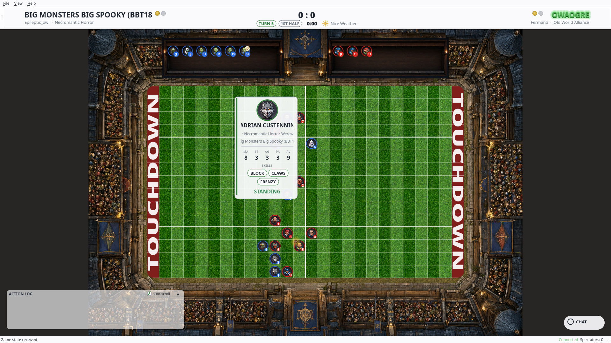
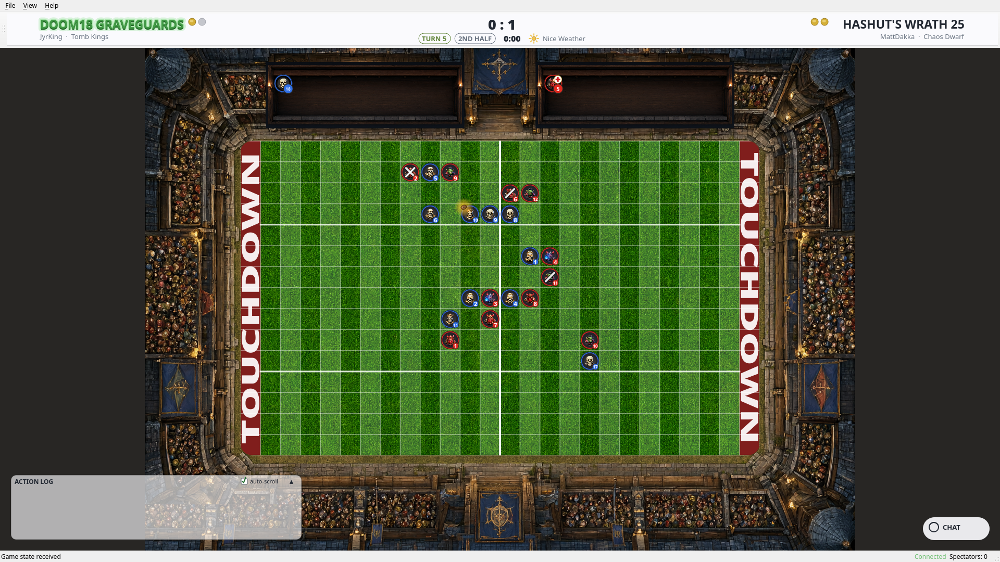
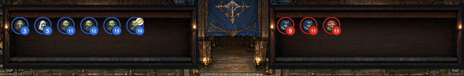
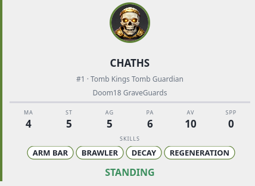

# FUMBBL Reborn

**A native, modern Blood Bowl spectator client for [FUMBBL](https://fumbbl.com).**



Watch any live match on FUMBBL in real time: the full field with a face for
every piece of all 31 BB2025 races, a dice log with real dice and player
names, chat, roster and player stats — floating where you want it, over a
stadium that looks the part.

Built in **native C++/Qt6**: it starts in a second, uses almost no
resources, and renders razor-sharp at 1080p, 4K and beyond. No browser,
no web view, no installers.

---

## Why FUMBBL Reborn?

- **Native, not a web page in a window.** C++/Qt6 with vector (QPainter)
  rendering: instant start, tiny footprint, and a pitch that stays crisp
  at any resolution.
- **Built for the 2025 rules (Third Season).** All 31 races, 127 unique
  pieces, race-aware name resolution — every piece on the field is
  *who they are*, not a generic token.
- **A HUD made for watching.** Floating, draggable, auto-snapping panels
  with a layout that remembers itself: score & turn header, **dice log
  with real d6 faces** (never bare numbers), live chat with unread badge,
  dugout reserves/KO/injured, player info card on hover.
- **The field feels alive.** Animated glow on the ball and the acting
  player, movement trails with move numbers, block markers between the
  pair, and rain when the gods get moody.
- **One download, zero setup.** Linux AppImage / tar.gz and a Windows
  zip — everything (Qt, assets, faces, dice) is bundled.

## Screenshots

| The field, live | The dugouts | The player card |
|---|---|---|
|  |  |  |

## Install

Grab the files you need from the
[**latest release**](https://github.com/jojom4n/fumbbl-reborn/releases).

### Linux (AppImage — recommended)

```bash
chmod +x FUMBBL-Reborn-*-x86_64.AppImage
./FUMBBL-Reborn-*-x86_64.AppImage
```

(Prefer not to use AppImages? The `*-linux-x86_64.tar.gz` is a
self-contained folder — unpack and run `FUMBBL-Reborn`.)

### Windows

Unpack `FUMBBL-Reborn-*-windows-x86_64.zip` anywhere and run
`FUMBBL-Reborn.exe`.

### First run

`File ▸ Spectate Game…` — enter your FUMBBL credentials (Client ID,
Client Secret and Username; they live in your FUMBBL account settings),
pick a live match and watch. Credentials are stored locally with `0600`
permissions, only on your machine.

## Features (spectator)

- **Live spectating** — the live match list, filterable by race, coach,
  team and division (or jump straight to a Game ID).
- **Real-time field** — players, ball and full game state, driven by the
  official FUMBBL protocol (OAuth2 + the public WebSocket channel).
- **Faces for every piece** — all 31 races of the 2025 edition, with
  race-aware name resolution (a `BBT18` werewolf is named like a werewolf).
- **Dice log** — every roll with the player's name, the skills that
  mattered, and the dice drawn as **dice**, not numbers.
- **Chat & spectators** — live match chat (send when you've joined) and
  the current spectator count.
- **Player info card** — hover or click any player: race, position,
  stats (MA/ST/AG/PA/AV) and skills.
- **Resilient connection** — automatic re-join with a fresh token when a
  session drops, and visible server errors instead of silent failures.

## About the development — a note on AI

This client was built with AI assistance: an LLM coding agent —
**Qwen 3.8**, running on the owner's own hardware — wrote the code and
an image model (Qwen-Image) generated the graphics (stadiums, faces,
icons), all under the direction of the project owner, who defined every
spec, made every engineering decision, and verified every result. The
owner is the author; the AI is the tool. If you prefer no-AI software,
this one has an AI footprint — you are free to use it, fork it (GPLv3) or
not.

## Roadmap

- [x] Spectate any live match
- [ ] Play your own team (in-game commands)
- [ ] Replays
- [ ] Team management / roster view

The protocol and model layers are already built with play in mind —
spectating is the first milestone, not the last.

## Disclaimer

This is an **unofficial, fan-made** project. It is not affiliated with,
endorsed by, sponsored by, or connected in any way to FUMBBL or its
operators and maintainers. “FUMBBL” and all related material are the
property of their legitimate owners. This client only connects to the
public FUMBBL service to spectate publicly available matches. It does not
modify, copy or redistribute any FUMBBL proprietary content. Provided
**“as is”, without warranty of any kind**.

## License

[GNU General Public License v3.0 or later](LICENSE).
