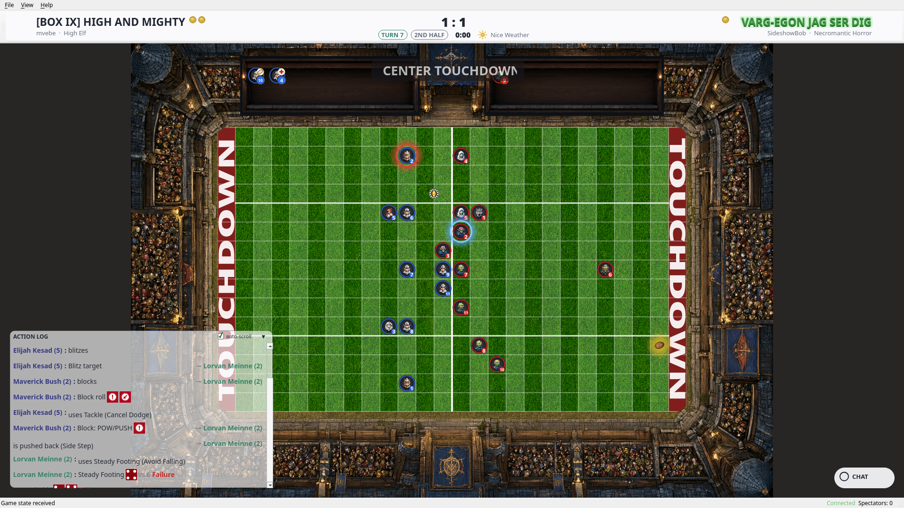
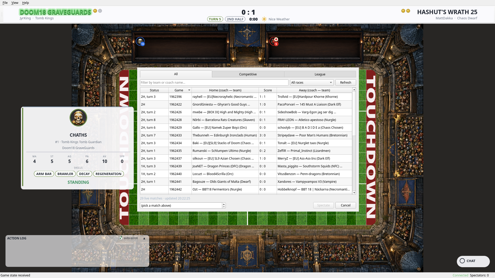

# FUMBBL Reborn

**A native, modern Blood Bowl spectator client for [FUMBBL](https://fumbbl.com).**


Watch any live match on FUMBBL in real time: the full field with a face for
every piece of all 31 BB2025 races, a dice log with real dice and player
names, chat, roster and player stats — floating where you want it, over a
stadium that looks the part.

Built in **native C++/Qt6**: it starts in a second, uses almost no
resources, and renders razor-sharp at 1080p, 4K and beyond. No browser,
no web view, no installers.

---

## Why FUMBBL Reborn?

- **Native, not a web page in a window.** C++/Qt6 with vector (QPainter)
  rendering: instant start, tiny footprint, and a pitch that stays crisp
  at any resolution.
- **Built for the 2025 rules (Third Season).** All 31 races, 127 unique
  pieces, race-aware name resolution — every piece on the field is
  *who they are*, not a generic token.
- **A HUD made for watching.** Floating, draggable, auto-snapping panels
  with a layout that remembers itself: score & turn header, **dice log
  with real d6 faces** (never bare numbers), live chat with unread badge,
  dugout reserves/KO/injured, player info card on hover.
- **The field feels alive.** Animated glow on the ball and the acting
  player, movement trails with move numbers, block markers between the
  pair, and rain when the gods get moody.
- **It tells you what matters.** Broadcast-style ribbons (CENTER
  TOUCHDOWN, 2ND HALF, EXTRA TIME, FULL TIME) and edge toasts (+SPP,
  completions, injuries, turnovers) — the highlights, at a glance.
- **One download, zero setup.** Linux AppImage / tar.gz and a Windows
  zip — everything (Qt, assets, faces, dice) is bundled.

## Screenshots

| The field, mid-action | The player card |
|---|---|
|  |  |
| The action log — dice are dice | The match list, live |
|  |  |

## Install

Grab the files you need from the
[**latest release**](https://github.com/jojom4n/fumbbl-reborn/releases).

### Linux (AppImage — recommended)

```bash
chmod +x FUMBBL-Reborn-*-x86_64.AppImage
./FUMBBL-Reborn-*-x86_64.AppImage
```

(Prefer not to use AppImages? The `*-linux-x86_64.tar.gz` is a
self-contained folder — unpack and run `FUMBBL-Reborn`.)

### Windows

Unpack `FUMBBL-Reborn-*-windows-x86_64.zip` anywhere and run
`FUMBBL-Reborn.exe`.

### First run

The client opens with a **sign-in dialog**: enter your FUMBBL account
credentials (your coach name and site password — the same ones you log in
to fumbbl.com with). The client verifies them against the live server
before it lets you in. With "Remember credentials" on (the default), the
password is stored in your **system keychain** (Windows Credential
Manager, macOS Keychain or Linux Secret Service): only its MD5 hash is
kept, never the plaintext. Without a keychain the client falls back to a
local `0600` file on your machine.

Then: `File ▸ Spectate Game…` — pick a live match and watch.

## Features (spectator)

- **Live spectating** — the live match list with per-division tabs,
  filter by race/coach/team, 20-second auto-refresh (your selection
  survives), or jump straight to a Game ID.
- **Real-time field** — players, ball and full game state, driven by the
  official FUMBBL protocol: the same coach + password challenge login
  the official Java client uses, on the public WebSocket channel.
- **Faces for every piece** — all 31 races of the 2025 edition, with
  race-aware name resolution (a `BBT18` werewolf is named like a werewolf).
- **Dice log** — every roll with the player's name, the skills that
  mattered, and the dice drawn as **dice**, not numbers.
- **Scoreboard that tells the story** — half display (PRE-GAME / 1ST /
  2ND / EXTRA TIME), turn, weather, SPP gain per player (red `+N`).
- **Toasts** — center ribbons for the big moments, edge pills for
  completions, regeneration, raise the dead, timeouts, injuries and
  turnovers.
- **Waiting board** — while a match is being joined: HOME VS AWAY plus
  the live session status.
- **Report card** — at full time: final score, both rosters with SPP and
  final player states.
- **Chat & spectators** — live match chat (send when you've joined) and
  the current spectator count.
- **Player info card** — hover or click any player: race, position,
  stats (MA/ST/AG/PA/AV), SPP and skills.
- **Resilient connection** — automatic re-join with a fresh challenge
  when a session drops, and visible server errors instead of silent
  failures.

## About the development — a note on AI

This client was built with AI assistance: an LLM coding agent —
**Qwen 3.8**, running on the owner's own hardware — wrote the code and
an image model (Qwen-Image) generated the graphics (stadiums, faces,
icons), all under the direction of the project owner, who defined every
spec, made every engineering decision, and verified every result. The
owner is the author; the AI is the tool. If you prefer no-AI software,
this one has an AI footprint — you are free to use it, fork it (GPLv3) or
not.

## Roadmap

The work is tracked as milestones in the
[issue tracker](https://github.com/jojom4n/fumbbl-reborn/issues) —
every entry there is a real, scoped item:

| Milestone | What's in it |
|---|---|
| [R0 — Spectator Quick Wins](https://github.com/jojom4n/fumbbl-reborn/issues?q=is%3Aissue+milestone%3A1) | Toasts & SPP, division tabs + auto-refresh, waiting board, report card, inducement icons |
| [R1 — Match Library & Replay](https://github.com/jojom4n/fumbbl-reborn/issues?q=is%3Aissue+milestone%3A2) | Local auto-archive of watched matches, replay viewer, highlights, live scrub, multi-rulebook (BB2016/2020/2025) |
| [R2 — Match Experience](https://github.com/jojom4n/fumbbl-reborn/issues?q=is%3Aissue+milestone%3A3) | Live stats panel, commentary toggle, focus mode, full report card (MVP, stats), full player card, audio engine, settings, i18n, coach home pane |
| [R3 — Platform](https://github.com/jojom4n/fumbbl-reborn/issues?q=is%3Aissue+milestone%3A4) | Auto-update, macOS build, ARM64 AppImage (Steam Deck / Pi), in-app bug reports, accessibility, guided onboarding |
| [R4 — Play Mode](https://github.com/jojom4n/fumbbl-reborn/issues?q=is%3Aissue+milestone%3A5) | Play your own team — same executable, in-game commands |

The protocol and model layers are already built with play in mind —
spectating is the first milestone, not the last.

## Disclaimer

This is an **unofficial, fan-made** project. It is not affiliated with,
endorsed by, sponsored by, or connected in any way to FUMBBL or its
operators and maintainers. “FUMBBL” and all related material are the
property of their legitimate owners. This client only connects to the
public FUMBBL service to spectate publicly available matches. It does not
modify, copy or redistribute any FUMBBL proprietary content. Provided
**“as is”, without warranty of any kind**.

## License

[GNU General Public License v3.0 or later](LICENSE).
